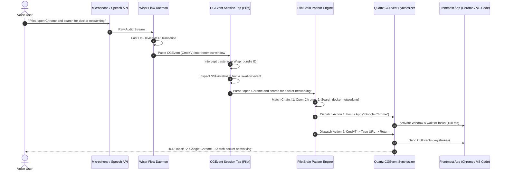

<div id="top"></div>

<div align="center">


# Hands-Free - Voice-Controlled macOS Assistant & Web Simulation

**A High-Performance System for Voice-Driven Computing.**  
*Turn Natural Speech Into Instant, Deterministic Desktop Action.*

<br />

[](https://nohandspilot.vercel.app)
[](https://youtu.be/svUKJ5K3ZRI)
[](LICENSE)
[](https://apple.com/macos)
[](https://swift.org)
[](https://react.dev/)
[](https://www.typescriptlang.org/)
[](https://tailwindcss.com/)
[](https://vitejs.dev/)
[](https://playwright.dev/)
[](CONTRIBUTING.md)

<br />

> 🌐 **Live Web Simulator**: Experience Hands-Free Pilot live in your browser at **[https://nohandspilot.vercel.app](https://nohandspilot.vercel.app)**  
> 🎥 **Video Demo & Walkthrough**: Watch the timed demo script running on live macOS at **[YouTube Walkthrough](https://youtu.be/svUKJ5K3ZRI)**

<br />

[Live Demo](https://nohandspilot.vercel.app) · [Video Demo](https://youtu.be/svUKJ5K3ZRI) · [About](#about) · [Foundational Principles](#foundational-principles) · [Quick Start](#quick-start) · [Core Features](#core-features) · [Visual Identity](#visual-identity--design-philosophy) · [Architecture](#architecture) · [Project Structure](#project-structure) · [Supported Commands](#supported-voice-commands) · [Documentation](#documentation) · [Contributing](#contributing) · [License](#license)

</div>

---

<div align="center">
  <h2>About</h2>
</div>

Most voice assistants suffer from **conversational drag**—they ask clarifying questions, introduce artificial latency, hallucinate non-deterministic actions, or require round-tripping through cloud AI models just to switch a window or click a button. Meanwhile, legacy accessibility software often relies on clunky numbered grids or sluggish speech engines that fail to keep pace with modern developer workflows.

**Hands-Free (Pilot)** is an open-source, dual-layer system designed for effortless, high-speed, voice-driven computing:
1. **A Native macOS Menu-Bar Daemon** written in **Swift 5.9** that intercepts speech dictation from Wispr Flow via low-level `CGEvent` taps, resolves commands deterministically in under 2 ms using `PilotBrain`, and synthesizes native keystrokes, clicks, window focus, and screen navigation through Apple Accessibility APIs.
2. **An Interactive Web Desktop Simulator** built with **React 19**, **TypeScript 5.9**, **Tailwind CSS v4**, **Vite**, and **Framer Motion** that runs the exact same matching engine in-browser, offering a sandboxed virtual macOS desktop environment to test voice commands and shortcuts before running them natively.

### Foundational Principles

1. **Zero-Latency Execution (<2 ms Matching)**: Voice command parsing uses a deterministic rule matcher (`PilotBrain`) rather than conversational LLM inference for routine desktop operations. Commands are evaluated in 1.4 to 1.9 ms.
2. **Clean Clipboard Isolation**: Wispr Flow dictates text by simulating a paste operation. Pilot intercepts the paste directly from Wispr's process bundle via session taps, swallows the clipboard payload before any frontmost application receives it, and keeps the user's system pasteboard uncontaminated.
3. **Dual Architecture with 100% Logic Parity**: The command matching rules, token normalization, context routing, and app aliasing are authored identically in Swift (`Brain.swift`) and TypeScript (`brain.ts`), verified by reciprocal unit test suites (`BrainCheck` and Vitest).
4. **Privacy-First Local Execution**: Pilot runs entirely on-device. Audio buffers for the "Pilot" wake word are processed locally via Apple's Speech framework, and command execution never leaves your Mac.
5. **Human-Centric Feedback**: Status is communicated through a floating HUD toast, a subtle menu-bar indicator, and a single warm amber waveform that illuminates strictly while Pilot is acting.

---

<div align="center">
  <h2>Quick Start</h2>
</div>

### Prerequisites

| Component | Native macOS App | Web Desktop Simulator |
|---|---|---|
| **Operating System** | macOS 14.0+ (Sonoma or Sequoia) | Any modern OS (macOS, Linux, Windows) |
| **Runtime / Compiler** | Swift 5.9+ / Xcode Command Line Tools | Node.js `v20.x` or higher |
| **Dependencies** | Wispr Flow (recommended for voice dictation) | `npm` (v10+) or `pnpm` |
| **Permissions** | Accessibility & Input Monitoring | None (Browser sandboxed) |

---

### Native macOS App Setup

```bash
# 1. Clone the repository
git clone https://github.com/TheVicky1/Hands-Free.git
cd Hands-Free

# 2. Build, run BrainCheck, sign, and install Pilot.app to ~/Applications
cd app
./build.sh

# 3. Launch Pilot from Applications
open ~/Applications/Pilot.app
```

#### Grant macOS Permissions (One-Time)
1. **Accessibility**: Open **System Settings → Privacy & Security → Accessibility** and toggle **Pilot** ON.
2. **Input Monitoring**: In **Privacy & Security → Input Monitoring**, ensure **Pilot** is authorized to observe global shortcut taps.
3. **Wispr Flow Dictionary**: In Wispr Flow Settings → Dictionary, add the term **`Pilot`** so voice triggers are never transcribed as "Pilate" or "pilot's".

---

### Web Desktop Simulator Setup

```bash
# 1. Navigate to the web workspace
cd web

# 2. Install reproducible dependencies
npm install

# 3. Start local Vite development server
npm run dev

# 4. Open in browser
# Navigate to http://localhost:5173
```

---

### Validation & Quality Gates

```bash
# Run Swift native BrainCheck test suite (27+ assertion benchmarks)
cd app && swift run BrainCheck

# Run Web unit test matrix (Vitest: brain matcher, simulator reducer, said parser)
cd web && npm test

# Run Playwright End-to-End browser test suite
cd web && npx playwright test

# Run ESLint quality audit
cd web && npm run lint

# Run TypeScript strict type verification
cd web && npm run typecheck

# Run production Vite compilation build
cd web && npm run build
```

---

<div align="center">
  <h2>Core Features</h2>
</div>

### 1. Native Swift Pilot Daemon (`app/Sources/Pilot/`)
- **`Hands.swift`**: Synthesizes hardware-level keyboard events, unicode character streams, smooth cursor trajectories, left/right clicks, and targeted scroll events using Quartz `CGEvent`. Focuses applications and waits for frontmost confirmation before typing.
- **`Screen.swift`**: Queries macOS Display Services and `AXUIElement` accessibility hierarchies to locate window bounds, controls, file dialogs, and button coordinates.
- **`Taps.swift`**: Hooks into macOS event taps at the session level to catch Wispr Flow pastes (`com.electron.wispr-flow`), inspect clipboard contents, match voice commands, and drop unwanted text cleanly.
- **`WakeWord.swift`**: Continuously listens for the "Pilot" wake word using Apple's on-device `SFSpeechRecognizer`. Employs smart partial-transcript guards to prevent false wakes on phrases like "No Hands Pilot".
- **`UI.swift`**: Houses the custom menu-bar status icon (airplane), dark/light appearance coordinator, floating HUD status toast with animation physics, and the "What can I say?" command cheat sheet window.
- **`main.swift`**: Coordinates application lifecycle, registers the global **`Control+Option+P`** shortcut for direct keyboard input, and maintains the daily usage count.

### 2. High-Speed Pattern Matcher (`PilotBrain/Brain.swift` & `web/src/brain/`)
- **Sub-2ms Evaluation**: Eliminates neural inference overhead for deterministic desktop commands.
- **App-Scoped Execution**: Commands containing prepositions ("search docker in Chrome", "find main in VS Code") automatically route to the target application without polluting the global search scope.
- **Multi-Action Chaining**: Splits continuous speech into sequential atomic steps using conjunctions (`"and"`, `","`, `", then"`).
- **Macro Expansion**: Translates conversational voice requests into multi-step UI operations (e.g. "upload the screenshot" navigates file dialogs via `Cmd+Shift+G`, pastes the latest screenshot path, downsamples if over 5 MB, and submits).

### 3. Interactive Web Desktop Simulator (`web/src/desktop/`)
- **Virtual macOS Environment**: A full in-browser replica of macOS with draggable windows, Dock bounce animations, active MenuBar with live clock, and realistic traffic light window controls.
- **Interactive CommandBar**: Type or dictate commands with live autocomplete, keyboard navigation, and immediate visual feedback.
- **Simulated Apps & Pages**: Includes functional stand-ins for Chrome, VS Code, Notes, Finder, Terminal, and System Settings.
- **Fluid Motion System**: Powered by Framer Motion with custom spring physics that honor user `prefers-reduced-motion` settings.

---

<div align="center">
  <h2>Visual Identity & Design Philosophy</h2>
</div>

Following [`web/DESIGN.md`](web/DESIGN.md), Hands-Free embodies a calm, precise, and cinematic aesthetic:
- **Palette**: Deep near-black ink (`#08090B`) paired with warm paper-white (`#F2EDE4`).
- **The Signal**: A singular cockpit caution amber (`#FFB02E` in dark mode, `#A85700` in light mode). The amber signal is reserved strictly for moments when Pilot is actively hearing or executing a command.
- **Typography**:
  - **Fraunces**: Variable display serif with high-contrast optical sizing for hero headlines.
  - **Instrument Sans**: Clean, modern humanist sans-serif for UI elements and explanatory prose.
  - **JetBrains Mono**: Monospace font for commands, parameters, code, and system metrics.
- **Texture**: Subtle 4.5% film grain overlay on the landing page creates depth without distracting from the crisp mock desktop.

---

<div align="center">
  <h2>Architecture</h2>
</div>

### System Execution Lifecycle



---

<div align="center">
  <h2>Project Structure</h2>
</div>

```
Hands-Free/
├── .gitignore                      # Git exclusion rules for macOS, Node, Swift
├── .vercelignore                   # Vercel deployment exclusions
├── app/                            # Native macOS Swift Application
│   ├── Package.swift               # SPM Manifest (Pilot, PilotBrain, BrainCheck)
│   ├── build.sh                    # Automated compilation, signing & install script
│   ├── Resources/                  # Native assets
│   │   ├── AppIcon.icns            # macOS Application icon bundle
│   │   ├── MenuIcon.png            # Standard menu-bar airplane icon
│   │   └── MenuIcon@2x.png         # Retina menu-bar airplane icon
│   └── Sources/
│       ├── BrainCheck/main.swift   # Verification harness with 27+ test cases
│       ├── Pilot/                  # Main application daemon
│       │   ├── Hands.swift         # CGEvent input synthesis (keys, clicks, scroll)
│       │   ├── Screen.swift        # AXUIElement hierarchy & coordinate mapping
│       │   ├── Taps.swift          # Session event taps for Wispr interception
│       │   ├── UI.swift            # Menu bar item, HUD toast & cheat sheet UI
│       │   ├── WakeWord.swift      # SFSpeechRecognizer on-device audio listener
│       │   └── main.swift          # NSApplication delegate & shortcut coordinator
│       └── PilotBrain/
│           └── Brain.swift         # Core voice pattern matcher & command resolver
├── commands/
│   └── commands.json               # Canonical dictionary of 84+ voice commands
├── docs/                           # Project technical documentation
│   ├── demo.md                     # Timed 2-minute live demo presentation script
│   ├── plan-review.md              # Architectural evaluation & technical decisions
│   ├── progress.md                 # Reverse-chronological engineering build log
│   └── setup.md                    # Detailed permissions & Wispr setup guide
├── scripts/
│   └── export-stats.mjs            # Usage metrics extraction script
└── web/                            # React 19 + TypeScript + Vite Web Simulation
    ├── package.json                # Web manifest and script definitions
    ├── vite.config.ts              # Vite bundling configuration
    ├── tsconfig.json               # Strict TypeScript compiler options
    ├── eslint.config.js            # ESLint code hygiene rules
    ├── index.html                  # HTML entrypoint with pre-paint theme script
    ├── DESIGN.md                   # Authoritative design system specifications
    ├── e2e/
    │   └── autoplay.spec.ts        # Playwright automated browser test suite
    ├── public/                     # Static web assets and mock statistics
    │   ├── favicon.svg             # Hand monogram logo with signal waveform
    │   ├── og.png                  # OpenGraph social preview card
    │   ├── robots.txt              # Search crawler directives
    │   ├── stats.json              # Real production usage metrics
    │   └── wispr-usage.png         # Wispr Flow Insights verification proof
    └── src/
        ├── main.tsx                # React application bootstrap
        ├── index.css               # Tailwind CSS v4 design tokens (@theme)
        ├── theme.ts                # System / Light / Dark theme store
        ├── motion.ts               # Framer Motion animation tokens
        ├── stats.ts                # Real-time usage statistics parser
        ├── brain/                  # TypeScript port of PilotBrain
        │   ├── brain.ts            # Rule matcher with 100% Swift parity

<!-- Work in progress: docs(readme): document website shortcuts and URL resolution rules -->
